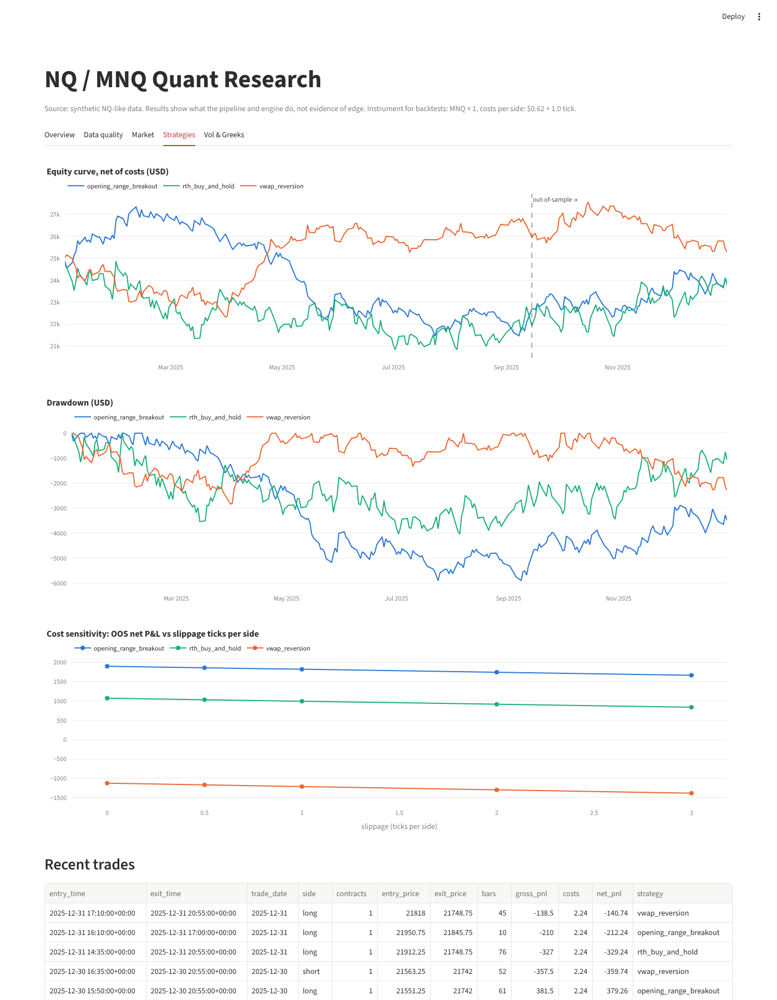

# NQ Quant Research

A research platform for **Nasdaq-100 futures (NQ / MNQ)**. It covers the full path from raw
1-minute bars to strategy decisions:

- **Medallion data pipeline** (bronze → silver → gold) on partitioned Parquet with a
  **data-quality gate**. The same validation rules run in **pandas** (local / Airflow) and
  **PySpark** (AWS Glue), and parity tests check that the two engines agree.
- **DuckDB** time-series query layer over the lake.
- **Airflow DAG** for daily, idempotent, retry-safe runs.
- **Cost-aware intraday backtester** with no look-ahead by construction, NQ/MNQ contract
  specs, IS/OOS walk-forward and slippage sensitivity.
- **Black-76 pricing, Greeks, implied vol and SVI smile fitting** for options on NQ futures.
- **Streamlit dashboard** covering data quality, market view, strategy P&L/risk and the vol smile.

> **Data note.** The default source is a deterministic *synthetic* NQ-like generator. It
> reproduces Globex hours, the intraday volatility U-shape, GARCH clustering, the 0.25 tick and
> realistic feed defects. It contains **no alpha**, so the backtest numbers below show how the
> engine and pipeline behave. They are not evidence of edge. Point `source: csv` at a vendor
> export (Databento, FirstRate, Kibot…) to run on real data; no code changes are needed.



## Quick start

```bash
pip install -e ".[dev,spark,dashboard]"
nqqr run all                 # ingest → validate → gold → backtests (≈25 s for a year of 1-min bars)
nqqr dashboard               # Streamlit UI on http://localhost:8501
pytest -q                    # 59 tests, 97% coverage
```

Real data:

```bash
nqqr run all --source csv --csv-path ~/data/nq_1m.csv --start 2024-01-02 --end 2024-12-31
```

## What a run produces (full year 2025, synthetic)

| Stage | Output |
|---|---|
| Bronze | 358,902 raw rows with lineage (`source`, `ingested_at`) |
| Silver | 358,190 rows. 610 quarantined (0.17%) across 5 rules, 102 exact duplicates dropped, 357 spikes flagged, 609 intrasession gaps counted |
| Gold | 71,760 five-minute bars × 260 sessions with ATR, session VWAP and returns |
| Research | 3 strategies, each with a parameter grid searched **in-sample only** (Jan–Sep), then evaluated once out-of-sample (Sep–Dec) |

| Strategy (MNQ ×1, $0.62 + 1 tick per side) | IS Sharpe | OOS Sharpe | Chosen params |
|---|---|---|---|
| Opening-range breakout | −1.15 | +1.50 | OR 60 min, stop 2.0 × ATR |
| VWAP reversion | +0.67 | −1.09 | z 2.5, lookback 48 |
| RTH buy-and-hold (benchmark) | −0.57 | +0.54 | none |

The sign flips between IS and OOS are the expected result on data with no edge, and they are
the reason for the IS/OOS discipline: picking the best of 9 grid points on noise produces a
positive in-sample Sharpe that does not survive out-of-sample.

## Architecture

```
            ┌──────────────┐  fetch()    ┌──────────────┐ validate_bars / process_market_data
 sources →  │ Synthetic /  │ ──────────▶ │   BRONZE     │ ─────────────────────────────┐
            │ vendor CSV   │             │ raw+lineage  │   pandas (local/Airflow)     │
            └──────────────┘             └──────────────┘   PySpark (AWS Glue) ─ parity│
                                                                                      ▼
  ┌──────────────┐  build_gold_bars  ┌──────────────┐   ┌──────────────┐    ┌────────────────┐
  │    GOLD      │ ◀──────────────── │   SILVER     │   │ QUARANTINE   │    │  DQ report +   │
  │ 5m features  │                   │ clean bars   │   │ row + reason │    │  gate (fail >  │
  └──────┬───────┘                   └──────────────┘   └──────────────┘    │  2% rejected)  │
         │ strategies → walk-forward → metrics                              └────────────────┘
         ▼
  ┌──────────────┐     ┌──────────────────────┐     ┌──────────────────────┐
  │ DuckDB       │ ──▶ │ Streamlit dashboard  │     │ Airflow DAG (daily,  │
  │ views+tables │     │ DQ / market / P&L /  │     │ 17:30 ET, idempotent │
  └──────────────┘     │ vol smile & Greeks   │     │ partition overwrite) │
                       └──────────────────────┘     └──────────────────────┘
```

Details are in [ARCHITECTURE.md](ARCHITECTURE.md). Design choices are recorded in
[docs/DECISION_LOG.md](docs/DECISION_LOG.md).

## Repository layout

```
configs/            instruments, costs, strategies, pipeline (validated with pydantic)
src/quant_research/
  ingest/           SyntheticSource, CsvSource, synthetic generator + defect injector
  transform/        rules.py (pandas engine), validation.py (Spark engine)
  storage/          lake.py (Hive-partitioned Parquet), warehouse.py (DuckDB)
  features/         resampling, session tagging, ATR, session VWAP, opening range
  strategy/         Strategy ABC + ORB, VWAP reversion, RTH benchmark
  backtest/         engine, metrics (Sharpe/Sortino/DD/VaR/ES), walk-forward
  pricing/          black76.py (price, Greeks, IV), svi.py (fit, arbitrage check)
  pipeline.py       stage orchestration used by the CLI and Airflow
  cli.py            `nqqr` entry point
dags/               Airflow DAG (works on Airflow 2.10+ and 3.x)
glue/               AWS Glue job (also runs locally with --local)
dashboard/          Streamlit app
tests/              unit + integration (engine parity, Glue, DAG, dashboard)
```

## Quality bar

- `ruff` lint and format, `mypy` type-checking, GitHub Actions CI on Python 3.12 and 3.13.
- **Engine parity test**: pandas and Spark must produce identical silver rows and quarantine
  counts. This test caught a real bug: Spark treats `NaN` as a value rather than null.
- **No-look-ahead test**: shocking future prices must not change any earlier position.
- **Reconciliation test**: summed trade P&L equals summed bar P&L.
- Black-76 is checked against Hull's textbook value, put-call parity and finite-difference
  Greeks. SVI is checked by recovering a known smile and by Durrleman's butterfly condition.
- The Airflow DAG was executed end to end with `airflow dags test` on Airflow 3.4.

## Deploying the Glue job

```bash
zip -r quant_research.zip src/quant_research
aws s3 cp quant_research.zip s3://$BUCKET/code/
aws s3 cp glue/transform_job.py s3://$BUCKET/code/
aws glue create-job --name nq-silver --role $GLUE_ROLE --glue-version 4.0 \
  --command Name=glueetl,ScriptLocation=s3://$BUCKET/code/transform_job.py \
  --default-arguments '{"--extra-py-files":"s3://'$BUCKET'/code/quant_research.zip",
    "--BRONZE_PATH":"s3://'$BUCKET'/lake/bronze/bars_1m/",
    "--SILVER_PATH":"s3://'$BUCKET'/lake/silver/bars_1m/",
    "--QUARANTINE_PATH":"s3://'$BUCKET'/lake/silver/quarantine/"}'
```

## Limitations and next steps

- Real vendor data has not yet been run through the pipeline. Next step: one year of Databento
  `ohlcv-1m` for NQ, with a continuous-contract roll (volume-based, back-adjusted).
- Stops are evaluated on bar closes. A tick- or 1-minute-level stop simulation would tighten
  the fill assumptions.
- Walk-forward uses a single IS/OOS split. Planned improvements are rolling windows and a
  deflated Sharpe ratio for the grid search.
- The vol module fits a synthetic chain. The next step is CME NQ option quotes, a multi-expiry
  surface and a calendar-arbitrage check.
